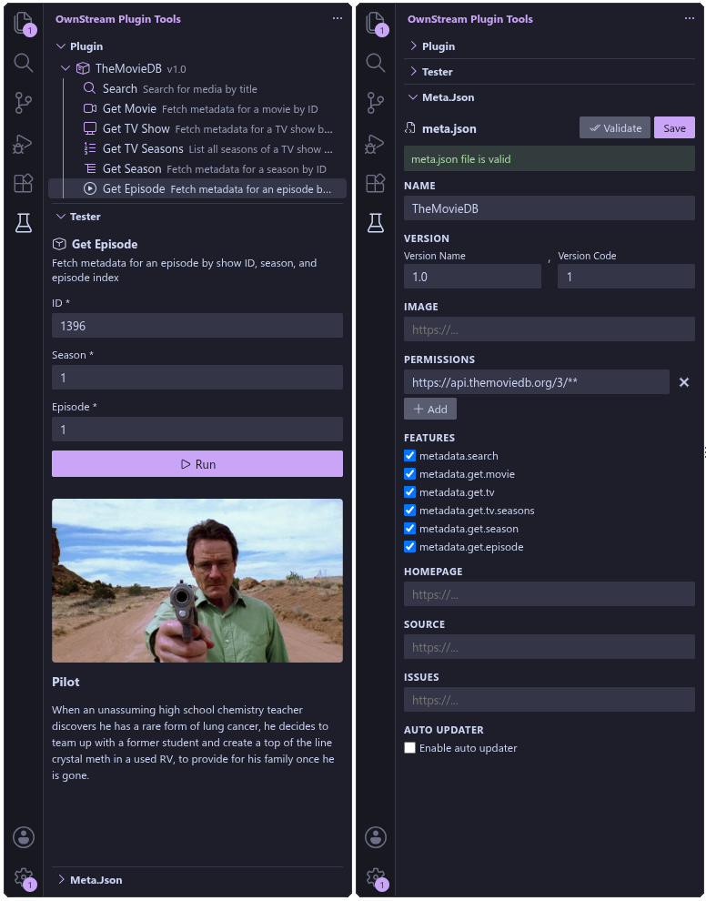

# VSCode extension for OwnStream plugins

Provides quick testing panels for OwnStream plugin development.

> [!WARN]
> This project contains a *lot* of LLM-generated code that hasn't been reviewed by a human. Abandon all hope all ye who enter here.

## Screenshots

## Usage
After installing, you MUST download the [OwnStream PluginCli](https://github.com/OwnStream/PluginCli), and set the path to the `OwnStream.PluginCli` executable in settings. Afterwards, opening a OwnStream plugin directory should automatically be recognized and testing options should be available.